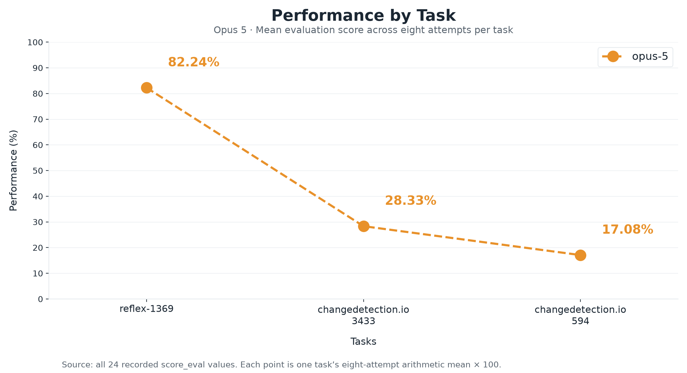
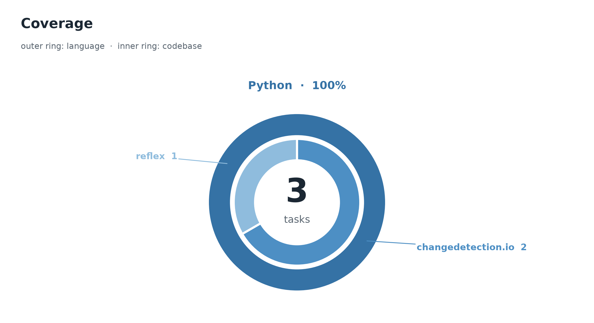

<p align="center">
  
</p>

**An evaluation of Opus 5 on three software-engineering tasks, with eight recorded attempts per task.**
These tasks bundle multiple announced issues from `reflex-dev/reflex` and
`dgtlmoon/changedetection.io`. Each includes the issue prompt, container definition, reference
patch, grading material, and recorded agent trajectories.

Across **24 runs**, the mean evaluation score is **42.55%**. **One run satisfies the full
test-success criterion**, covering **one of the three tasks**. The headline score includes partial
credit; it is not the percentage of tasks solved.

The set carries one task per measured tier — Easy, Hard, and Expert — so the three span the
difficulty range rather than clustering. Charts and tables are computed from the shipped bundles.
All use the same task ordering and source values; image labels are rounded only for display, with
decimal ties rounded up.

## Summary

| Property | Value |
| --- | --- |
| Tasks | **3**, spanning **21 announced issues** |
| Agent | `opus-5` (`anthropic/claude-opus-5`) |
| Runs | **8 per task; 24 total**, with every run from 1 to 8 present |
| Judge | `gpt-5.6-sol` on all 24 process records |
| Measured difficulty | **Easy 1 · Hard 1 · Expert 1** |
| Network configuration | Agent and verifier both declare `network_mode = "none"` |
| Score | `score_eval` in [0, 1], combining test outcome and process |
| Codebases | 2 (`reflex-dev/reflex`, `dgtlmoon/changedetection.io`) |
| Quality coverage | 24 records; 21 scored, 3 unjudged |

| Metric | Recorded result |
| --- | --- |
| **Mean evaluation score** | **42.55%** |
| Mean test-outcome score | 42.00% |
| Mean process score | 0.6515 |
| Mean quality score, scored runs only | 0.5034 (n = 21) |
| Full-test successes (`score_binary = 1`) | **1 / 24 (4.17%)** |
| Tasks with at least one full-test success in eight runs | **1 / 3 (33.33%)** |
| Total recorded agent cost | **$440.64 across 24 attempts** |
| Mean recorded episodes / turns | 340.96 / 168.88 |
| Turns per run | 109–267, every run above 100 |

Costs refer to recorded agent usage, without adding judge or infrastructure costs. The records
contain **613,985,433 prompt tokens**, **601,037,082 cached tokens**, and **2,367,994 completion
tokens**; prompt and cache fields are reported separately, and recorded episodes and trajectory
steps are distinct counters.

## Difficulty tiers

A measured tier is assigned from the **arithmetic mean of the eight `score_eval` values for a task**.
The bands below use explicit inclusive/exclusive boundaries.

| Tier | Mean `score_eval` band | Task | Runs | Mean score |
| --- | --- | --- | --- | --- |
| Easy | 0.500 ≤ μ < 0.875 | `reflex-dev__reflex-1369` | 8 | 82.24% |
| Hard | 0.250 ≤ μ < 0.375 | `dgtlmoon__changedetection.io-3433` | 8 | 28.33% |
| Expert | 0 ≤ μ < 0.250 | `dgtlmoon__changedetection.io-594` | 8 | 17.08% |

No task measures Trivial or Medium. The Medium band, 0.375 ≤ μ < 0.500, is empty: the observed
means fall either side of it, and no label was assigned that a run did not earn.

Each `task.toml` now carries the tier its eight runs measured, so the stored label and this report
agree on all three tasks.

## Results

### 1. Per-task performance

| Task | Mean score | Min–max | Turns (min–max) | Mean turns | Full-test successes | Measured tier |
| --- | --- | --- | --- | --- | --- | --- |
| [reflex-1369](56e866ec-41f7-428b-9c91-51b9787ce934/instruction.md) | **82.24%** | 79.07%–98.55% | 109–135 | 125.6 | 1 / 8 | easy |
| [changedetection.io-3433](8ab81969-37a0-4f3b-86af-d21560f386ce/instruction.md) | **28.33%** | 6.79%–92.64% | 189–267 | 235.8 | 0 / 8 | hard |
| [changedetection.io-594](5fee266c-fa53-41c7-bdbd-285e188670ac/instruction.md) | **17.08%** | 6.84%–88.45% | 120–171 | 145.2 | 0 / 8 | expert |

The table reports each task’s arithmetic mean and observed minimum–maximum span. The span
describes these eight observations; it is not a confidence interval. Turns are agent steps recorded
in `final_metrics.total_steps`; every run in this set exceeds 100.

#### Performance by task

<picture>
  <source media="(prefers-color-scheme: dark)" srcset="images/performance_by_task-dark.png">
  <source media="(prefers-color-scheme: light)" srcset="images/performance_by_task-light.png">
  
</picture>

The x-axis lists the three tasks; the y-axis shows **Performance (%)**, calculated as the mean
of each task’s eight `score_eval` values × 100. Points use the same task order and means as the
per-task table above. Performance includes partial credit; full-test successes are counted separately.

### 2. All eight attempts

| Task | R1 | R2 | R3 | R4 | R5 | R6 | R7 | R8 | Mean |
| --- | --- | --- | --- | --- | --- | --- | --- | --- | --- |
| reflex-1369 | 79.93% | 98.55% | 80.75% | 79.85% | 79.57% | 80.13% | 79.07% | 80.05% | 82.24% |
| changedetection.io-3433 | 92.46% | 92.64% | 6.82% | 6.97% | 7.07% | 7.07% | 6.79% | 6.82% | 28.33% |
| changedetection.io-594 | 6.85% | 7.00% | 6.86% | 88.45% | 6.84% | 6.92% | 6.87% | 6.88% | 17.08% |

The single full-test success occurs at **`reflex-1369/run_2`**. Its evaluation score is below
100% because process is also graded. Run numbers identify separate recorded attempts, not stages in a learning curve.

### 3. Outcome and process

| Task | Mean outcome | Mean process | Mean `score_eval` |
| --- | --- | --- | --- |
| reflex-1369 | 0.8250 | 0.7986 | 0.8224 |
| changedetection.io-3433 | 0.2800 | 0.3988 | 0.2833 |
| changedetection.io-594 | 0.1550 | 0.7570 | 0.1708 |

Outcome and process means use all eight runs per task.

The composition can increase or decrease the outcome score. For example,
`changedetection.io-594` rises from 0.1550 mean outcome to 0.1708 mean evaluation, while
`reflex-1369` falls from 0.8250 to 0.8224. `score_eval − outcome` is the net effect of replacing some outcome weight with process,
not a separate additive reward.

## Analysis

**The means conceal large differences in repeatability.** `reflex-1369` stays between 79.07%
and 98.55%, with seven runs passing 4/5 target tests and one passing all five. It is the only task
here that ever reaches full test success, and it does so once in eight attempts.

**The two lower-scoring changedetection.io tasks have distinct high and low groups.** On
`changedetection.io-594`, seven runs pass 2/37 targets; run 4 passes 33/37. Its median evaluation
score is **6.88%**, compared with a **17.08%** mean. On `changedetection.io-3433`, runs 1–2 pass
33/35 targets, while runs 3–8 pass 2/35; the median is **7.02%**, compared with a **28.33%** mean.
These eight-run means describe substantial observed variation, rather than establishing stable
long-run difficulty estimates.

The failure logs provide context for those groups. The low-scoring
[`changedetection.io-594/run_3`](5fee266c-fa53-41c7-bdbd-285e188670ac/trajectories/opus-5/run_3/verifier/test-stdout.md)
contains widespread `werkzeug.routing.BuildError` failures. In
[`changedetection.io-3433/run_3`](8ab81969-37a0-4f3b-86af-d21560f386ce/trajectories/opus-5/run_3/verifier/test-stdout.md),
many failures assert that rendered HTML should contain `has-unread-changes`.
These are observed failure patterns, not a claim that every failed assertion has an independent cause.

**No run in this set breaks a preserve-set test.** Every recorded regression factor is 1.0, so each
outcome score reflects target recall alone with no regression penalty applied.

**Full-test success covers the recorded target and preserve sets.** The prompts contain 21
announced issues, and not every requirement is directly exercised by those test sets. For example,
all five targets for `reflex-1369` concern websocket namespace configuration; its prompt contains
six issues. Process criteria provide additional evidence about scope and implementation, so a
binary test success should not be read as proof that every announced issue was completely resolved.

## Coverage

<picture>
  <source media="(prefers-color-scheme: dark)" srcset="images/language_coverage-dark.png">
  <source media="(prefers-color-scheme: light)" srcset="images/language_coverage-light.png">
  
</picture>

All three tasks are Python. The outer ring is language coverage; the inner ring splits the same
three tasks by codebase, `dgtlmoon/changedetection.io` 2 and `reflex-dev/reflex` 1.

## Dataset structure

```text
<uuid>/
├── task.toml                  # identity, stored tier, resources, network policy
├── instruction.md             # complete multi-issue prompt
├── environment/Dockerfile     # environment definition
├── solution/
│   ├── fix.patch              # supplied reference patch
│   ├── solve.sh               # reference-patch application script
│   └── TRUTH.md               # reference account of defects and requirements
└── tests/
    ├── config.json            # repository, base commit, commands, transition sets
    ├── test.patch             # grading tests
    ├── test.sh                # verifier entrypoint
    ├── run_tests.py           # test execution and strict transition checks
    ├── test_output.py         # deterministic process checks
    ├── rubrics.json           # process criteria and source-site probes
    └── quality.json           # fixed seven-item quality definition
```

## Trajectory structure

```text
<uuid>/trajectories/opus-5/run_N/       # N = 1…8
├── result.json                       # agent metrics, scores, diagnostics, assay
├── config.json                       # run configuration
├── agent/
│   ├── trajectory.json               # ATIF-v1.7 structured trace
│   ├── recording.cast                # terminal recording
│   └── opus.pane                     # pane snapshot
├── artifacts/
│   ├── agent.patch                   # recorded agent diff
│   └── manifest.json                 # artifact index
└── verifier/
    ├── score.md                      # recorded outcome
    ├── final_score.md                # readable score breakdown
    ├── test-stdout.md                # test execution output
    ├── process.json                  # detailed process and composed scores
    ├── verdicts.jsonl                # process judge log
    ├── quality.json                  # seven-item quality result; may be unjudged
    └── quality_verdicts.jsonl         # quality judge log
```

Outcome and process values come from `result.json → verifier_result.scores`; their detailed
counterparts are in `verifier/process.json`. Code-quality scores come from
`verifier/quality.json → score`. All 24 runs contain the structured trajectory, the terminal
recording, the standalone patch, and the quality files; 21 of those files carry a numeric score and
three are unjudged.

## Scoring methodology

### Mean evaluation score and full-test success

```text
task mean = sum(score_eval for runs 1…8) / 8
overall mean = sum(the three task means) / 3
full-test success rate = count(score_binary == 1) / 24
observed eight-run task coverage = count(tasks with any score_binary == 1) / 3
```

This report uses **mean evaluation score** for the continuous average, keeping it distinct
from success within eight attempts. The observed
eight-run success coverage here is **33.33%**; the mean evaluation score is **42.55%**.

### Outcome and process

The stored continuous outcome values reproduce the following calculation from the diagnostics:

```text
recall = hits_new / t_eff_total
outcome = round(recall × regression_factor, 2)
process = (score_deterministic + score_rubric) / 2
score_eval = gate × ((1 − 2α) × outcome + 2α × process)
```

`t_eff_total` removes baseline-passing targets; the preserve-set regression penalty reduces
credit when required P2P tests break. All 24 records have an open gate (`gate = 1`).
α takes the stored values **0.013158, 0.013889, and 0.050000**, making the
process weight approximately **2.63–10.00%** and the outcome weight **90.00–97.37%**.

`score_rl` uses the same composition with a process value normalized within an outcome stratum.
It is not used for the report's means or tiers. The stored stratum sizes vary across runs.

Across the three current process-rubric definitions there are **43 judged items**, including **12 with
negative weights**, and **24 source sites**. The rubric dimensions contain 16 issue-coverage,
9 honesty, 7 verification, 5 maintainability, 3 adherence, and 3 scope-discipline items.
The 24 process records contain **344 item evaluations**, including **21 rubric abstentions**;
the verdict logs also contain 344 lines. Recorded rubric criteria and weights can differ from
the current definitions, so these files are not treated as an exact replay specification.

Each definition configures 14 hard and 14 soft check types. The actual process logs emit **13 hard
and 24 soft checks per run**, including expanded site checks; `A5-trajectory-present` is not
separately emitted. All **312 emitted hard checks pass**. This distinction avoids counting every
configured check type as an executed hard gate.

## Reproduction

No trajectory re-execution is needed to recompute the reported scores from the shipped
bundles. Run this example from the repository root:

```python
import json, glob, collections, statistics

ev = collections.defaultdict(list); solved = collections.Counter()
for f in glob.glob("*/trajectories/opus-5/run_*/result.json"):
    uuid = f.split("/")[0]
    sc = json.load(open(f))["verifier_result"]["scores"]
    ev[uuid].append(sc["score_eval"])
    solved[uuid] += int(sc["score_binary"] == 1.0)

for uuid in sorted(ev):
    tier = [l for l in open(f"{uuid}/task.toml") if l.startswith("difficulty")][0].split('"')[1]
    print(f"{uuid} {tier:8s} mean={statistics.mean(ev[uuid]):.4f} solved={solved[uuid]}/8")
```

All README images live directly in `images/`. The `<picture>` elements select dark or light
charts according to the viewer’s theme, with the light version as the fallback.

The tier axis is that per-task mean, banded as Trivial 0.875 ≤ μ, Easy 0.500 ≤ μ < 0.875,
Medium 0.375 ≤ μ < 0.500, Hard 0.250 ≤ μ < 0.375, Expert μ < 0.250. Per-run costs and token
counts come from `trajectories/opus-5/run_N/agent/trajectory.json` under `final_metrics`.

## Verification and limitations

Every number in this report was recomputed from the shipped bundles rather than carried over: the
complete 3 × 8 run grid, task and model identity, evaluation and outcome composition, and agreement
between the result and process records. This validates the saved arithmetic; it does not
independently replay the grading.

- **Small, concentrated sample.** Three tasks come from two repositories, using one agent and one
  process judge. Eight attempts reveal observed variation but do not establish population-level
  performance, statistical independence, or inter-judge agreement.
- **Tier resolution.** One task occupies each populated band, so a tier mean is a single task mean.
  No task measures Trivial or Medium.
- **Quality coverage.** All 24 runs ship an exported agent patch and a quality record. 21 carry a
  numeric quality score and 3 are unjudged. Every run records non-zero cost.
- **Recorded checks have limits.** The hard checks report no upstream-content fetches, oracle-path
  reads, graded-test writes, or test evasion. The soft `C6-no-unknown-breaks` check fails on all eight
  `reflex-1369` runs, each reporting one unknown break outside the preserve set. Its binary successes
  still refer specifically to the required target and preserve sets.
- **Replay needs the original runtime.** The Dockerfiles reference registry-hosted base images.
  Continuous/process composition is present in the scored records, while the shipped
  `run_tests.py` implements strict transition validation. Rebuilding full evaluation would require
  the corresponding harness and judge setup in addition to these task files.
- **Provenance scope.** The supplied configurations record repository identity and base commits.
  These three `task.toml` files do not contain an `[upstream_provenance]` block,
  and no corpus audit verdict or contamination-screen evidence is included here. No SHIP disposition,
  dataset licence, or zero-overlap claim is established by these bundles.

<details>
<summary>Task identities and pinned base commits</summary>

| Task | UUID | Base commit |
| --- | --- | --- |
| reflex-1369 | `56e866ec-41f7-428b-9c91-51b9787ce934` | `bfec196d84b6122646297100a553751ff5c6548c` |
| changedetection.io-3433 | `8ab81969-37a0-4f3b-86af-d21560f386ce` | `cbeefeccbb5c69a71c1946efd99402649af2f465` |
| changedetection.io-594 | `5fee266c-fa53-41c7-bdbd-285e188670ac` | `0e385b1c22b5c031e450d9b9c226e89e759ee4db` |

</details>
