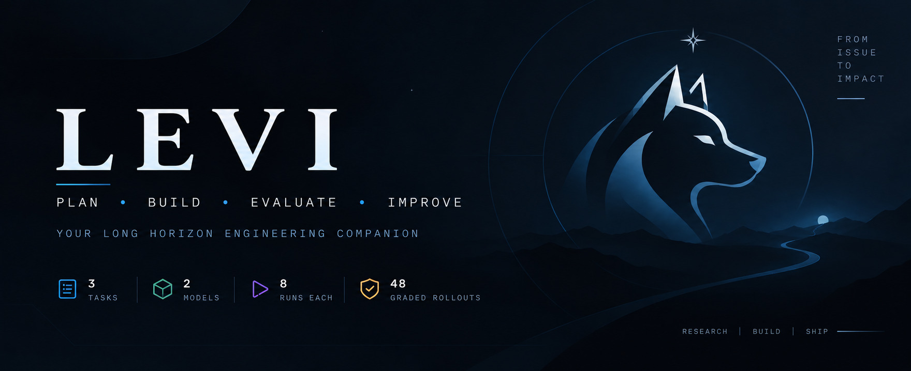
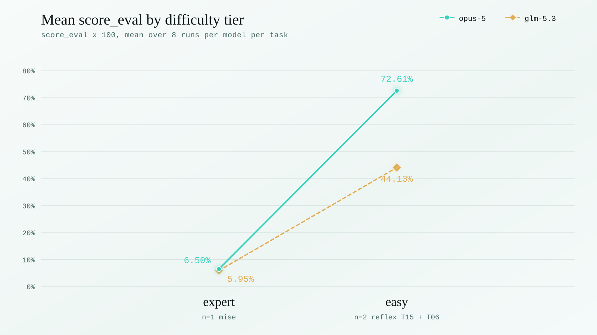
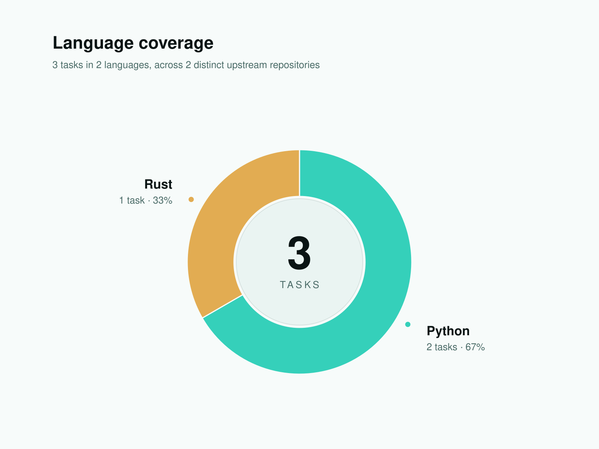
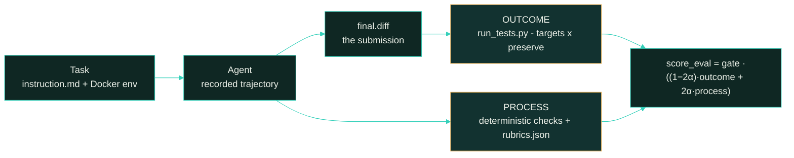

<p align="center">
  
</p>

<p align="center">
  <strong>Levi — measuring agentic software-engineering capability on real, offline issue-resolution tasks, graded on outcome and on process.</strong>
</p>

<p align="center">
  <a href="#scoring-methodology"></a>
  <a href="#dataset-structure"></a>
  <a href="#difficulty-tiers"></a>
</p>

<p align="center"><sub>
  <a href="#summary">Summary</a> · <a href="#repository-layout">Layout</a> · <a href="#the-three-tasks">Tasks</a> · <a href="#difficulty-tiers">Tiers</a> · <a href="#results">Results</a> · <a href="#analysis">Analysis</a> · <a href="#dataset-structure">Dataset</a> · <a href="#trajectory-structure">Trajectories</a> · <a href="#scoring-methodology">Scoring</a> · <a href="#running-a-task">Running</a> · <a href="#reproduction">Reproduction</a> · <a href="#limitations">Limitations</a>
</sub></p>

# Levi: 3-Task Evaluation Sample

**Levi measures agentic software-engineering capability on real issue-resolution tasks, graded both
on outcome and on how the work was done.**

Each task takes a real span of merged upstream work, pins the repository to the commit immediately
before that work landed, and asks an agent to resolve the issues from scratch — offline, with no
access to the upstream solution. Grading adds a **process-scoring layer** on top of the pass/fail
test outcome, so a run that reaches the right answer by the wrong route is distinguishable from one
that does not.

This sample is narrow and deep: **3 tasks × 2 models × 8 runs = 48 graded rollouts.** Each per-task
figure below is a mean over eight attempts rather than a single observation.

> Curated, quality-controlled sample. Dataset format, trajectory format and scoring are identical to
> the corpus it is drawn from.

## Summary

| Property | Value |
| :--- | :--- |
| Tasks | **3**, across 2 distinct upstream repositories |
| Models | `claude-opus-5` (`anthropic/claude-opus-5`) and `glm-5.3` (`zai/glm-5.3`) |
| Runs & grid | 8 per model per task = **48 total**; full 2 × 8 grid, no gaps |
| Agent scaffold | `openhands-sdk`; per-run trajectories recorded |
| Agent network | sealed — `no-network` for the agent phase |
| Grader | vendored in-bundle at `tests/levi_grader`, driven by `tests/test.sh` |
| Images | 6 multi-arch (`amd64` + `arm64`) tags in one ECR repo, pinned by index digest |

## Repository layout

```
images/                    hero + charts used by this README
<task-uuid>/
├── task.toml              Harbor task config: images, verifier, network, metadata
├── instruction.md         what the agent was given
├── environment/
│   ├── Dockerfile         builds the sanitised agent image from the measured base
│   ├── manifests.patch    dependency-manifest slice for the offline crate cache (mise only)
│   └── sanitize-entrypoint.sh
├── tests/                 the grader — copied into the verifier at grade time
│   ├── test.sh            the only entrypoint
│   ├── levi_grader/       grade.py, judge.py, __main__.py
│   ├── run_tests.py       outcome channel
│   ├── harness_core.py    output parsers
│   ├── graded/run.sh      the graded test command
│   ├── test_output.py     deterministic process checks
│   ├── config.json        f2p/p2p ids, commands, base commit
│   ├── rubrics.json       13 rubric items
│   └── test.patch         the hidden graded tests
├── solution/              gold patch, TRUTH.md, grounding, provenance, solve.sh
└── trajectories/
    ├── claude-opus-5/run_1..run_8/
    └── zai__glm-5.3/run_1..run_8/
```

## The three tasks

| UUID | Slot | Repo | Span | Language | F2P / P2P |
| :--- | :--- | :--- | :--- | :--- | :--- |
| `4c7b8d6f-c500-585d-b7b2-3519df55b1b3` | S01 | `jdx/mise` | `v2026.4.3..v2026.4.4`, 42 PRs | Rust | 5 / 545 |
| `6bf0c918-e9ad-5397-bb76-cf3e238f2df1` | T15 | `reflex-dev/reflex` | `v0.3.1..v0.3.2` | Python | 18 / 286 |
| `873914cf-93b2-57a0-a5c8-264bfa2d3b66` | T06 | `reflex-dev/reflex` | `v0.1.18..v0.1.19` | Python | 8 / 150 |

The two reflex tasks are the same repository at very different points in its history — T06 predates
the project's rename from pynecone. Different base commits, different graded sets, different images.

## Difficulty tiers

Assigned from pass@8 measured per model, where a *pass* means every graded target resolved
(`reward == 1.0`).

| Task | Tier | `claude-opus-5` pass@8 | `glm-5.3` pass@8 |
| :--- | :--- | ---: | ---: |
| mise | `expert` | 0 / 8 | 0 / 8 |
| reflex T15 | `easy` | 4 / 8 | 0 / 8 |
| reflex T06 | `easy` | 1 / 8 | 0 / 8 |

`glm-5.3` solved none of the three outright across 24 attempts. It does earn substantial partial
credit, so the strict pass@8 figure understates it.

## Results

### Mean score_eval by tier

| Tier | Tasks | `claude-opus-5` | `glm-5.3` |
| :--- | ---: | ---: | ---: |
| `expert` | 1 | **0.0650** | 0.0595 |
| `easy` | 2 | **0.7261** | 0.4413 |
| **Overall** | 3 | **0.5057** | **0.2807** |

<picture>
  <source media="(prefers-color-scheme: dark)" srcset="images/score_eval_by_tier-dark.svg">
  <source media="(prefers-color-scheme: light)" srcset="images/score_eval_by_tier-light.svg">
  
</picture>

Both models fall by roughly an order of magnitude from `easy` to `expert`, so the shipped tier order
holds for both. The gap between them does not: opus-5 leads by 0.285 on `easy` and by 0.006 on
`expert`, where neither model resolves a single graded target and the little that separates them is
process score alone.

Per-task figures, for reference:

| Task | Category | `claude-opus-5` | `glm-5.3` |
| :--- | :--- | ---: | ---: |
| mise | `expert` | **0.0650** | 0.0595 |
| reflex T15 | `easy` | **0.7987** | 0.3674 |
| reflex T06 | `easy` | **0.6535** | 0.5151 |

## Analysis

**mise scores zero on outcome for all 16 runs, and that needs reading carefully.** Every one of the
eight `claude-opus-5` runs modified `src/plugins/core/dotnet.rs` and `docs/lang/dotnet.md` — the
models did implement the requested .NET runtime feature, and all 545 preserve tests passed in every
run. They scored 0/5 because the five graded targets are exact snapshot tests in `mise_toml` and
`zsh`, and none exercises the .NET objective. The failures are identifier and ordering mismatches
(`depends: None` vs `depends: []`, a missing zsh hook flag), not absent functionality.

So mise's `expert` tier reflects a graded set that does not observe its stated objective. Treat the
number as a property of the task as much as of the models.

**`glm-5.3` trails consistently without being absent.** On reflex T06 it averages 0.516 against
opus-5's 0.641 while never fully solving. Its failures cluster on partial target resolution rather
than regressions — preserve suites stay green.

**Two reflex `glm-5.3` runs score zero through a collection cascade.** A submission that makes a
module unimportable causes every test in it to count as broken, tripping the preserve-set regression
gate and zeroing an otherwise ~0.56 run. The grader is behaving as designed — a submission that
breaks 126 preserved tests has broken them — but it widens apparent variance beyond the capability
gap.

## Coverage

<picture>
  <source media="(prefers-color-scheme: dark)" srcset="images/tasks_by_language-dark.svg">
  <source media="(prefers-color-scheme: light)" srcset="images/tasks_by_language-light.svg">
  
</picture>

**2 distinct upstream org/repo pairs**, one of them used twice at different points in its history.
Language is read from each task's `task.toml` `keywords[0]`.

| UUID | Repo | Language | Tier |
| :--- | :--- | :--- | :--- |
| `4c7b8d6f…` | `jdx/mise` | Rust | `expert` |
| `6bf0c918…` | `reflex-dev/reflex` | Python | `easy` |
| `873914cf…` | `reflex-dev/reflex` | Python | `easy` |

## Dataset structure

Each task ships everything needed to grade it offline:

- **Agent image** — sanitised. Built from the upstream measured image with the reference patch, the
  hidden tests and the upstream git history removed, then flattened to a single layer so nothing
  survives under a whiteout. The agent runs `no-network`.
- **Verifier image** — built `FROM` the sanitised agent image, ensures pytest, bakes `/tests`.
- **`tests/`** — the grader, copied into the verifier by Harbor after the agent finishes.
- **`solution/`** — the gold patch and `solve.sh`, mounted only for oracle runs.

## Trajectory structure

18 files per run:

```
config.json  lock.json  result.json
agent/       trajectory.json  openhands_sdk.txt  run_agent.py
artifacts/   manifest.json
verifier/    final.diff  grading.json  verdicts.jsonl  final_score.md
             reward.json  reward.txt  reward_reason.json  summary.json
             target-stdout.md  preserve-stdout.md  test-stdout.txt
```

`final.diff` is the submission. `reward.json` is the outcome channel only. `grading.json` carries
every channel, its state, and the composed `score_eval`.
`verdicts.jsonl` holds the 13 rubric verdicts. `trajectory.json` is the step-by-step record the
process channel is graded against.

## Scoring methodology

Two channels are computed per run and composed into a single headline score.



The outcome channel and the process channel, composed:

```
OUTCOME   tests/run_tests.py     graded targets x preserve set, via tests/graded/run.sh
PROCESS   tests/test_output.py   deterministic site and requirement checks, under pytest
          tests/rubrics.json     13 rubric criteria

process    = mean(deterministic, rubric)
score_eval = gate x ((1 - 2a) x outcome + 2a x process),   a = 0.05
```

So `score_eval` is `0.9 × outcome + 0.1 × process`. Outcome dominates; process differentiates runs
that reach the same outcome by different routes. A hard-gate failure in the deterministic channel
voids the run (`invalid.json`) rather than scoring it.

The rubric half of the process channel is the only part needing network egress. Without a judge key
it is skipped cleanly and grading returns outcome plus the deterministic checks.

**Grader hardening.** `test.sh` runs the grader from `/` with `python3 -P` so a submission cannot
shadow an import; it always exits 0; and on a crash it discards the output directory in favour of
`invalid.json`, because anything left there may have been planted. Submissions that edit
grader-controlled paths — `.cargo/**`, `**/conftest.py`, `pytest.ini`, `.gitattributes`,
`rust-toolchain*` and similar — are refused outright, independently of the test-patch ownership
check.

## Running a task

```bash
export AWS_DEFAULT_REGION=ap-south-1
aws ecr get-login-password --region ap-south-1 \
  | docker login --username AWS --password-stdin \
    426628337772.dkr.ecr.ap-south-1.amazonaws.com

harbor run 4c7b8d6f-c500-585d-b7b2-3519df55b1b3
```

Results land in `/logs/verifier`: `reward.json` is the outcome channel (what Harbor reads);
`grading.json` carries every channel plus the composed `score_eval`.

### Images

One ECR repository, six multi-arch tags, all pinned by index digest in `task.toml`:

```
426628337772.dkr.ecr.ap-south-1.amazonaws.com/levi

levi:4c7b8d6f            agent      sha256:8548f5c7004d60da6a8eaca625e5fb7152c40e355eada9a6bdea339b73fff6bf
levi:6bf0c918            agent      sha256:b4d482d8e163d741ac086af764c04daabcd6aee412850fee8a80d8881d90f4ab
levi:873914cf            agent      sha256:eca2d8710d1baffad6f1d273610bbce183857c73bed6574dce2252fb3fb446aa
levi:verifier-4c7b8d6f   verifier   sha256:371309e436035e7997742b425ecde38ae36f265a4f0aabf30d7075adf52d4615
levi:verifier-6bf0c918   verifier   sha256:b4f47752dd4bec2cd8d2be68229a4bf675744ea4e47ce4fd5d3a6250e019146a
levi:verifier-873914cf   verifier   sha256:8b36520ad92cd7e5b8f761cc7879cc56e69050698a31bcd19cb0020e6b16c4d1
```

Pull access to `repository/levi` is sufficient. The upstream *measured* base images live in a
separate namespace and are **not** required to run a task — they still contain the reference
solution and hidden tests.

## Reproduction

```
null submission    outcome 0.0    no graded target resolved
oracle (solve.sh)  outcome 1.0    every graded target resolved, offline, reproducible
```

Both were measured inside the pinned images with the network disabled. Oracle runs twice produce
byte-identical summaries, so the outcome channel is deterministic.

The rubric half of the process channel is not bit-reproducible. It is sampled at `temperature=1`.
Re-grading will shift rubric verdicts; the deterministic checks and the outcome channel will not.

## Limitations

- **mise's graded set does not cover its stated objective.** 0/5 targets touch the .NET runtime
  feature the instruction asks for; the five snapshot targets sit in unrelated subsystems. This is
  the single most important caveat in the sample.
- **The deterministic channel's weighting is uniform** over recorded site checks in this release.
  The `checks` array inside each run's `grading.json` preserves the per-check gates and weights from
  the original scoring, so the two can be reconciled, but a re-grade will not reproduce the shipped
  deterministic value exactly.
- **`reward.json` carries the outcome channel only.** The composed `score_eval` and the
  deterministic and rubric channels live in `grading.json`.
- **`glm-5.3`'s reflex T15 arm spans two batches** four days apart, including three resampled runs.
- **Two graded artifacts are exact-text snapshots.** Snapshot tests reward matching the reference's
  private naming and ordering, which the instruction does not state — depressing scores for
  functionally correct work, most visibly on mise.
